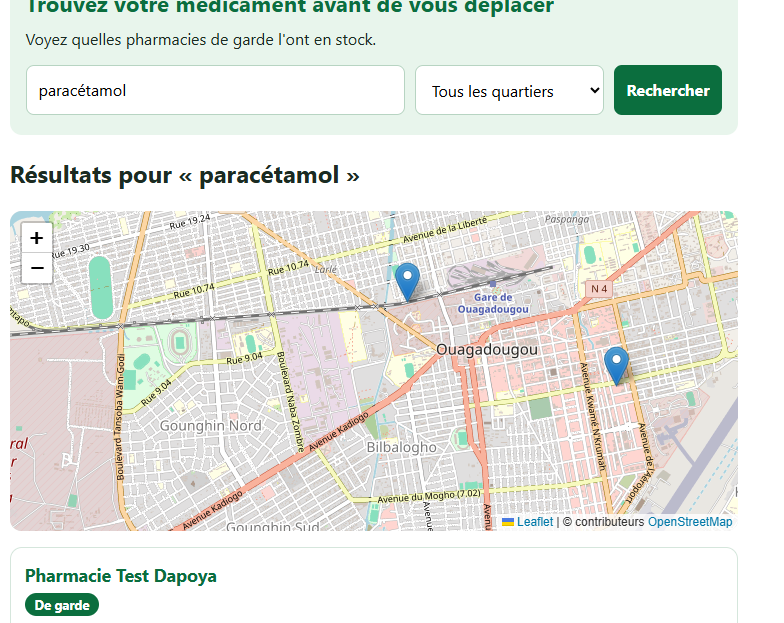

# PharmaGarde

*Trouver un médicament dans une pharmacie de garde, avant de se déplacer.*

Application web (Laravel et MySQL) pensée pour Ouagadougou : un usager cherche un médicament depuis son téléphone et voit, sur une liste et sur une carte, quelles pharmacies de garde l'ont en stock.

## Le problème

La nuit, le week-end ou un jour férié, on perd du temps à passer de pharmacie en pharmacie pour trouver celle qui est de garde *et* qui possède le bon médicament. PharmaGarde permet de le vérifier avant de partir.

## Fonctionnalités

| Espace | Fonctionnalités |
|---|---|
| *Usager* (sans compte) | Recherche d'un médicament par nom, filtre par quartier, résultats paginés, carte interactive avec fenêtre d'information |
| *Pharmacien* | Connexion, tableau de bord, mise à jour du stock (disponibilité et quantité) de *sa* pharmacie uniquement |
| *Administrateur* | Validation ou suspension des pharmacies, planning des gardes par dates (sans chevauchement), statistiques, journal d'audit |

## Technologies

- PHP et *Laravel 13* (architecture MVC, Eloquent, Blade)
- *MySQL* (migrations, seeders, clés étrangères, index)
- *Leaflet* et *OpenStreetMap* pour la carte (gratuits, sans clé d'API)
- *Git* et *GitHub* (une branche par fonctionnalité)
- Développé avec PHP 8.5 et MySQL 8.4 sous Ubuntu (WSL2)

## Sécurité

- Mots de passe *hachés* ; identifiants, clés et secrets dans .env, jamais publiés (.env.example sert de modèle)
- Protection *CSRF* sur tous les formulaires, et *injection SQL* évitée grâce à Eloquent (requêtes préparées)
- Protection *XSS* : affichage échappé par Blade, textContent dans les fenêtres de la carte, Js::from pour les données envoyées à JavaScript
- *Validation* côté serveur de toutes les entrées
- *Autorisations par rôle* (middleware) et *par propriétaire* (Policy) : un pharmacien ne peut pas modifier le stock d'une autre pharmacie (faille IDOR évitée)
- Protection contre l'*élévation de privilèges* : le rôle n'est jamais modifiable depuis un formulaire ($fillable)
- *Limitation des tentatives* de connexion (5 par minute) et renouvellement de la session après connexion
- *Journal d'audit* des validations de pharmacies et des modifications du planning
- Pages d'erreur personnalisées qui ne révèlent aucun détail technique
- Intégrité des scripts externes vérifiée (attribut integrity sur Leaflet)
- Les comptes de démonstration ne sont jamais créés en production

## Installation

Prérequis : PHP, Composer, MySQL et Git.

~~~bash
git clone https://github.com/michaelsacko04-del/pharmagarde.git
cd pharmagarde
composer install
cp .env.example .env
php artisan key:generate
~

Créez la base de données et un utilisateur dédié (remplacez le mot de passe par le vôtre) :

~~~sql
CREATE DATABASE pharmagarde CHARACTER SET utf8mb4 COLLATE utf8mb4_unicode_ci;
CREATE DATABASE pharmagarde_test CHARACTER SET utf8mb4 COLLATE utf8mb4_unicode_ci;
CREATE USER 'pharma_user'@'localhost' IDENTIFIED BY 'votre-mot-de-passe';
GRANT ALL PRIVILEGES ON pharmagarde.* TO 'pharma_user'@'localhost';
GRANT ALL PRIVILEGES ON pharmagarde_test.* TO 'pharma_user'@'localhost';
FLUSH PRIVILEGES;
~

Dans le fichier .env, renseignez la connexion :

~~~env
DB_CONNECTION=mysql
DB_HOST=127.0.0.1
DB_PORT=3306
DB_DATABASE=pharmagarde
DB_USERNAME=pharma_user
DB_PASSWORD=votre-mot-de-passe
~

Puis créez les tables, remplissez-les de données de test et lancez le serveur :

~~~bash
php artisan migrate --seed
php artisan serve
~

L'application est disponible sur http://127.0.0.1:8000. Aucune installation de Node.js n'est nécessaire.

## Comptes de test

Créés par le seeder, *uniquement en local* (refusés en production) :

| Rôle | E-mail | Mot de passe |
|---|---|---|
| Administrateur | admin@pharmagarde.test | TestPharma-2026 |
| Pharmacien (Tanghin) | pharmacien1@pharmagarde.test | TestPharma-2026 |
| Pharmacien (Dapoya) | pharmacien2@pharmagarde.test | TestPharma-2026 |

Les pharmacies, noms, téléphones et coordonnées de la base sont *fictifs*, uniquement pour la démonstration.

## Tests

26 tests automatiques vérifient la recherche, les accès par rôle, la limitation des connexions, la modification du stock (y compris l'interdiction de toucher au stock d'une autre pharmacie) et le planning des gardes. Ils utilisent une base séparée (pharmagarde_test) et ne touchent jamais aux données de développement.

~~~bash
php artisan test
~

## Modèle de données

| Table | Rôle |
|---|---|
| users | Comptes et rôles (usager, pharmacien, admin) |
| pharmacies | Pharmacies, coordonnées, validation, propriétaire (user_id) |
| medicaments | Liste des médicaments |
| stocks | Lien pharmacie et médicament : disponibilité et quantité (clé unique sur le couple) |
| gardes | Périodes de garde d'une pharmacie (début et fin) |

Une pharmacie est « de garde » si une garde couvre la date du jour (Pharmacie::deGarde()).

## Pistes d'amélioration

- Mise en ligne de l'application (HTTPS)
- API REST documentée et export des statistiques
- Alertes quand un médicament redevient disponible
- Notifications par SMS

## Auteur

*Sacko*, étudiant en Génie Informatique, Ouagadougou (Burkina Faso).
GitHub : [michaelsacko04-del](https://github.com/michaelsacko04-del)
